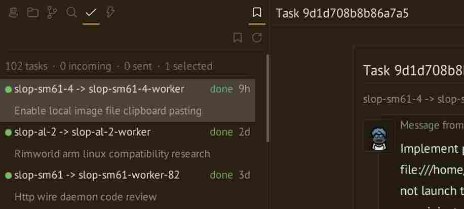

# Agent collaboration

Tasks carry assignments and reports between agents. Workers are agents spawned
for an assignment. Each agent’s saved permissions control its CLI and API access.
Host sessions remain accessible only with the root token.

## Worker delegation

Start with a working agent in a project, as in [Quickstart](../getting-started/quickstart.md).
This example creates a persistent worker so you can inspect its terminal afterward.

### Prerequisites

1. Save a working agent as a template using **Save as template**, or create one
   in Library. See [Configuration and templates](configuring-agents.md#templates).
2. If an agent will spawn workers, enable delegation and choose allowed templates
   in **Edit agent > Permissions**. The host can use any catalog template;
   scoped agents can use only allowed templates in their own project.

### Assignment and reporting

1. In a host shell, list templates, then spawn a worker. Replace `repo` and
   `review` with your project and template names:

   ```sh
   slopctl template list --project repo
   slopctl worker spawn --project repo --template review "Review the README and report unclear setup steps. Do not edit files."
   ```

2. Keep the returned task ID. Open **Tasks** in the sidebar to read its dialogue,
   or run `slopctl task wait ID` to wait for its final result. Workers receive
   their task ID and connection credentials automatically.
3. The worker reads and accepts the task, reports progress, and finishes or fails
   it using the [task commands](../reference/slopctl.md#task-commands). Configure its initial
   instructions under **Settings > Agents > Workers** if it needs this guidance.
4. Read the final report. For tasks that change files, follow
   [Git](../workspace/review-changes.md). Use a
   [new worktree](../workspace/project-worktrees.md#create-and-use-a-worktree) when the worker
   should edit an independent checkout.

The worker prompt can refer to `$SLOPWORLD_TASK_ID`. It is separate from the
prompt used when creating an agent.

### Parent-worker access

Open **Edit agent > Permissions** to set current authority. Changes take effect when
Save succeeds, including for existing workers and open connections; no restart is
needed. Templates provide initial permissions for new agents.

| Permission | Choices |
| --- | --- |
| Send follow-ups | Deny, Own workers, Project agents |
| Cancel tasks | Deny, Own workers, Project agents |
| Type in terminals | Deny, Own workers, Project agents |
| Stop or restart agents | Deny, Own workers, Project agents |
| Delete agents | Deny, Own workers, Project agents |
| Manage worktrees | Deny, Project worktrees |

Own workers means direct children bound to the parent's stable identity. Project
agents excludes host terminals. Parents can always read their workers' diagnostics.
Follow-ups and cancellation default to Own workers; other actions default to Deny.
Agents retain access to their own terminal and task updates. Deletion needs explicit
permission and cannot target the caller itself. Worktree management covers creation,
rename, and removal; external checkout registration remains root-only. Listing stays
available within the agent's project.

Worker spawning, allowed templates, and recursive spawning are separate controls below
the permissions. Delegation is disabled by default. New workers receive the stricter
permissions and delegation settings of their parent and template. Editing a worker
changes what that worker can do, not what its parent can do.

An agent with **Send follow-ups** permission for the recipient can send
`slopctl task followup --id ID "Check the tests"` to wake a running interactive
worker or an existing agent assigned a mailbox task. The daemon waits for readiness
and records the request and submission outcome in task history. Submission does not accept or reopen
the task. Follow-ups are rejected for canceled tasks, stopped workers, and shell
workers. Use a new worker when the process has exited.

### Cleanup and retries

A persistent worker remains available after its process exits. Remove it when
inspection is complete; remove any worktree separately. `--one-shot` instead
removes the worker session on exit. If a worker stops before finishing its task,
read the failure and create a new task to retry. See
[Worker lifecycle](../reference/slopctl.md#workers-and-templates).

## Task mailboxes



The Tasks view is global; the workspace Project filter does not hide its rows.
For delegation to an existing agent, use `slopctl task delegate AGENT "description"`
within the permissions below. Mailbox arrival does not wake the recipient. Keep
the returned ID and, for immediate delivery to a running interactive agent, use
`slopctl task followup --id ID "Read and accept this task"`. This requires
**Send follow-ups** permission and waits for the agent to be ready.

Agents can report to `host`, the user at the keyboard. Sending assignments to other
agents uses the Send follow-ups scope. Terminal permissions and task participation
are separate. See [Using slopctl](../reference/slopctl.md) for task
commands, statuses, and lifecycle.

Tasks are shared by sender and recipient. Only the recipient can update an
uncanceled task. Recipients can cancel queued or accepted tasks. The root token
can cancel those and unfinished worker assignments through the task board, API, or
`slopctl task cancel ID`. Agents with **Cancel tasks** permission can cancel
unfinished tasks addressed to recipients within that scope, including ordinary
working tasks without being a participant. Cancellation does not stop the process.
Participants can remove terminal tasks; root can also remove unfinished tasks. Only root can send as `host`.

Task details and `slopctl task show ID` retain the original assignment and every
subsequent update in order, with sender, status, and time. Progress reports remain
available after completion and daemon restarts. Removing or pruning a task also
removes its history.

For batch cancellation and removal failure behavior, see
[Task batch operations](../reference/api.md#task-batch-operations).

## Credentials and connectivity

Every newly launched agent receives `SLOPD_URL` and `SLOPD_TOKEN` automatically.
The token identifies that agent; its current saved policy determines access to other
agents. There are no manually issued session grants or `ro`/`rw` token scopes.
Host terminals and administrative configuration remain root-only.

Credentials survive daemon restarts while the same process and stable identity
survive. Stop, exit, failed launch, rename, removal, or identity replacement revokes
credentials. A fresh launch receives a new token. Credentials are stored privately
in `<DATA>/credentials.toml`.

Agents need network reachability to the daemon API. `network = "none"` prevents
this access. See [Network configuration](configuring-agents.md#network) and the
[Security model](../sandbox/security.md).
