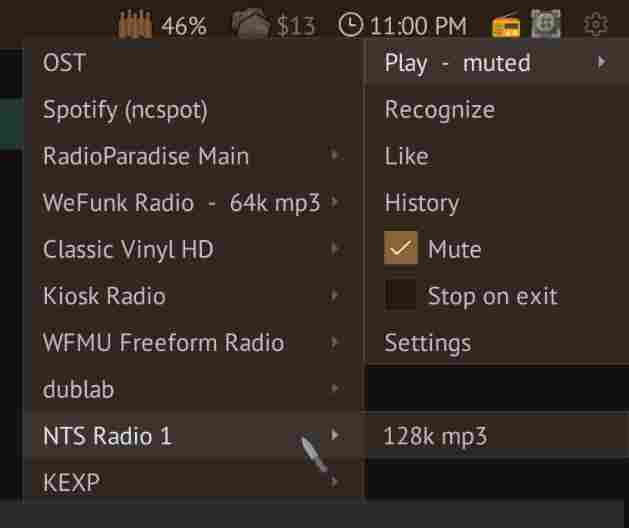

# Jukebox

Open the map jukebox or status-bar jukebox control. The OST is a built-in source;
**Settings > Audio > Sources** controls its visibility.

If the daemon cannot open or play the OST, RimWorld plays the bundled tracks locally.

For daemon audio playback, install `rtkit` on the machine running the daemon
and make its system D-Bus available so the daemon
can request real-time scheduling for its audio output thread. Playback continues
without that priority if the request fails; the daemon journal records the failure.

## Internet radio

Add a radio station with **Settings > Audio > Add source**. Edit or remove sources
in the Sources table. ICY metadata supplies the track display. Volume multiplies
RimWorld's audio settings; mute stops daemon playback and downloads.

The full menu offers song recognition through `songrec`, Like, and History.
Install `songrec` on the game machine; recognition uses its local audio output,
with `pactl` selecting the default output monitor.
Likes are saved locally; see [Paths and files](../reference/paths.md) for stations
and liked-song locations.

## Spotify via ncspot

This feature requires Spotify Premium and `ncspot` installed on the machine
running the daemon, with audio output available there. Sidecar mode does not
support Spotify playback. The source is hidden when ncspot is unavailable; hide it manually through
Settings if desired.

1. Install `ncspot`.
2. Choose **Play → Spotify (ncspot)**.
3. Complete ncspot's login.
4. Choose music in its terminal.

Muting or switching to OST/radio closes `ncspot`. Unmuting starts it again. Use its
terminal to resume or choose music. **Stop on exit** also applies. Playback and
Spotify library controls remain in `ncspot`. "Like" button writes only SlopWorld's local likes.

## Sidecar limitations

Sidecar mode uses RimWorld to play the bundled OST.

Internet radio, song recognition, and Spotify playback are not available.
