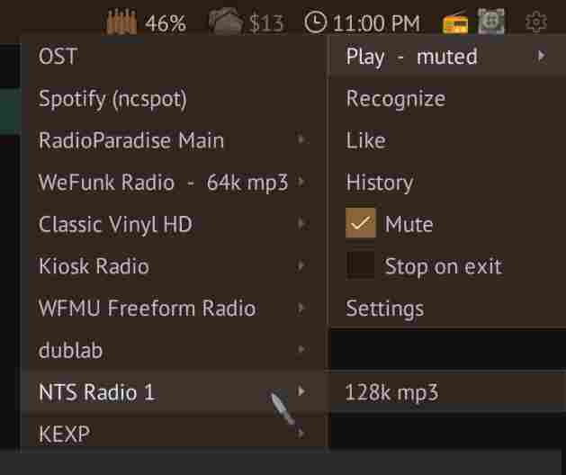

# Jukebox

Open the map jukebox or status-bar jukebox control. The OST is a built-in source;
**Settings > Audio > Sources** controls its visibility.

Native RimWorld always plays the bundled OST locally. The daemon plays radio and Spotify.
Switching back to OST waits for the daemon to stop, so the two players do not overlap.

In slopweb, open **Jukebox → Output** to choose where you hear music.

- **This device** (default) plays the OST or a radio station in your browser.
  Each listener can choose a different source and volume. If the browser asks for
  interaction before playing, click or press a key. Pausing radio disconnects the
  stream. Playing again joins the live broadcast.
- **Server** plays through the named daemon host. Everyone controlling that server
  sees the same selection and volume. Pause keeps the selection so any client can
  resume it. The latest command controls playback. If shared controls ask for a
  daemon update, update `slopd` or choose **This device** for local playback.

The browser remembers your output. Switching outputs stops local sound and leaves
the server player alone. On returning to **This device**, press Play to hear your
local selection again. With **Server** selected, **Stop shared player on exit** stops shared
playback when you close the workspace normally, even if another device last changed
the music.

Playback controls act on tracks for OST and on stations for radio. Switching radio
stations preserves the closest available bitrate. Pausing stops playback; playing
restarts the selected source. Spotify track selection stays in its terminal.

For daemon audio playback, install `rtkit` on the machine running the daemon
and make its system D-Bus available so the daemon
can request real-time scheduling for its audio output thread. Playback continues
without that priority if the request fails; the daemon journal records the failure.

## Internet radio

Add a radio station with **Settings > Audio > Add source**. Edit or remove sources
in the Sources table. ICY metadata supplies the track display. Volume multiplies
RimWorld's audio settings; pausing a station releases its stream at the selected output.

For song recognition, install `songrec` on the game machine; it uses local audio output,
with `pactl` selecting the default output monitor.
Likes are saved locally; see [Paths and files](../reference/paths.md) for stations
and liked-song locations.

## Spotify via ncspot

This feature requires Spotify Premium and `ncspot` installed on the machine
running the daemon, with audio output available there. Sidecar mode does not
support Spotify playback. In slopweb the menu explains when Spotify is unavailable. In native RimWorld the
source is hidden when ncspot is unavailable.

1. Install `ncspot`.
2. Choose **Tune → Spotify (ncspot)**.
3. Complete ncspot's login.
4. Choose music in its terminal.

In slopweb, choosing Spotify selects **Server** and opens its player. Switching output back to **This device** leaves Spotify playing on the server. Pausing the server or choosing OST/radio on the server closes `ncspot`. Playing starts it again. Use its
terminal to resume or choose music. **Stop on exit** also applies. Playback and
Spotify library controls remain in `ncspot`. "Like" button writes only SlopWorld's local likes.

## Sidecar limitations

Native RimWorld plays the bundled OST in sidecar mode. In slopweb, **This device** also plays browser-supported radio streams through the sidecar. The sidecar needs no speakers for this. Shared audio output, song recognition, and Spotify are unavailable in sidecar mode.

## Radio output

In **Settings → Audio**, use **Server audio device** in slopweb or **Radio output** in
native RimWorld to choose where the daemon plays shared OST and radio. Leave
Output and Backend on **Auto** for normal use. Auto prefers buffered PulseAudio-compatible output. Auto shows the detected output in parentheses. The list contains outputs exposed by the daemon host's audio system.
With a sound-server output, use desktop sound settings to choose speakers or
headphones. **Refresh outputs** updates the list and shows the currently open output.

The advanced backend preference can favor PulseAudio-compatible output (including
PipeWire's Pulse server) or the system default. Direct PipeWire output is not offered. If a selected output
cannot open, the daemon falls back automatically. **Save** persists the choice on
the daemon host and reconnects any playing radio stream; **Discard** restores the
saved settings. These choices do not route RimWorld's OST/game sounds or Spotify.
