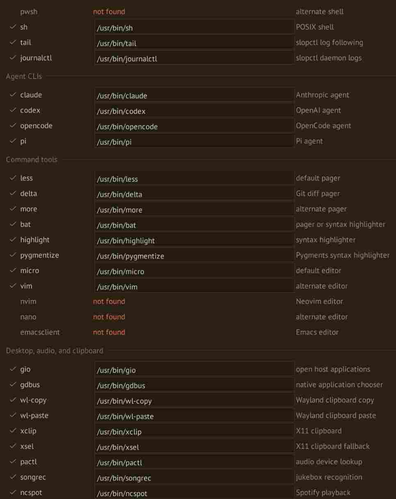
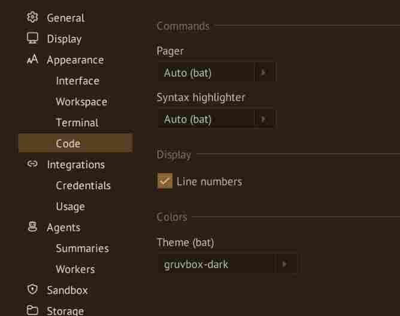
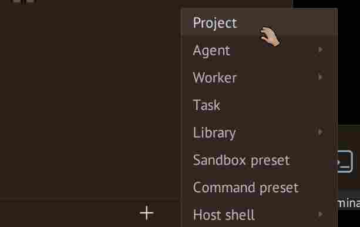
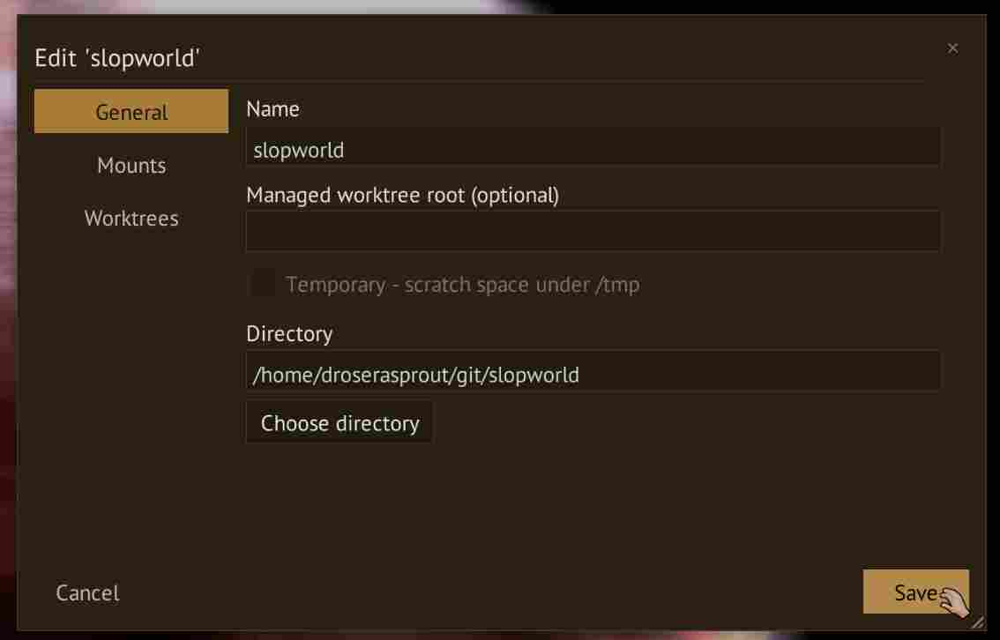

# Quickstart

A quick tour covering core concepts and usual workflow.

First, finish the [Linux](../installation/linux.md) guide for native Linux, [macOS](../installation/macos.md)
or [Sidecar mode](../installation/sidecar.md) for other environments.

## Prepare your tools

Install the optional CLI tools you want to use on the machine running the daemon. In sidecar mode, that means inside the container.

SlopWorld integrates with these tools to some extent:

- Agents: `codex`, `claude`, `pi`, `opencode`.
- VCS, search: `git`, `git-delta`, `rg`.
- Code and diffs: `bat`, `less`, `delta`, `pygmentize`, `highlight`.
- Editors: `micro`, `vim`, `nvim`, `nano`, `emacsclient`.
- Shells: `bash`, `zsh`, `fish`, `nu`, `pwsh`.

If your favorite agent or tool is missing, it **doesn't** mean it's not supported. You can create custom app presets in settings; see [Command presets](../workspace/command-presets.md#custom-presets).

## Prepare the workspace

Launch the game with `slopworld`. Look around.

The sidebar holds your agents, files, and Git changes. Selecting an agent opens
its terminal. See the [interface tour](../workspace/interface.md) for the other controls.
If the workspace cannot connect to the daemon, follow
[Troubleshooting](../resources/troubleshooting.md).

1. Choose preferred pager and highlighter under **Settings > Appearance > Code**.
2. Choose preferred shell and editor under **Settings > Apps > Defaults**.
3. Visit **Appearance** to configure fonts, colors, UI scale, and, most importantly, mouse cursor.

## Open a host shell

Select **[+] > Host Shell > ~** in the sidebar.

This is a regular Linux shell attached to tmux session. It's persistent and will survive if you close the game and keep `slopd` daemon running.

This shell runs on the daemon host, outside the agent sandbox. In sidecar mode,
it runs inside the container. See [Host shells](../terminals/host-shells.md) for stopping,
restarting, and removing the terminal tab.

Press **F12** to toggle terminal from any screen. Oh, and press **?** on the main screen to show other keyboard shortcuts.

## Add a project

1. Open **[+] > Project** in the sidebar.
2. Give the project a name and set its directory to the absolute path of your repository on the host (or inside the container if you're in sidecar mode).
3. Save the project.

The project directory is writable by default. For additional paths or read-only
access, see [Configuring projects](../workspace/configuring-projects.md).

## Create an agent

1. Open **[+] > Agent > Custom**.
2. Give the agent a name and select the project you just added.
3. Leave **Worktree** at **Main checkout**. Under **Command**, select the preset
   for your installed CLI. Leave **Command line override** and **Arguments** blank
   for this walkthrough.
4. Visit **Sandbox** to enable sandbox presets suitable for your project.
5. Open **Preview** to inspect the settings and project mounts, then save.
6. Find the agent in the **Agents** tab. If it is stopped, press **S** shortcut or choose **Start** from RMB context menu. Select the agent to open its terminal.

Complete any setup prompts shown by the CLI. If startup fails, use the error
message with [Troubleshooting](../resources/troubleshooting.md). See
[Configuring agents](../agents/configuring-agents.md) for the remaining settings.

<!-- Manual screenshot: agent editor with project, Main checkout, and CLI selected.
     Caption: Choose the project and the CLI this agent will run. -->

## Give it a task

Enter a small request in the agent's terminal, for example:

> Inspect this project and create a short hello-world.md describing its contents.
> Do not change any other files.

Interact with the CLI as you would in a normal terminal, including any approval
prompts. **Working** and **Idle** reflect terminal activity; an idle terminal
does not necessarily mean the task is finished.

<!-- Manual screenshot: agent terminal showing the request and completed response.
     Caption: Give your agent a small, concrete first task. -->

## Review the result

1. When the agent reports completion, open **Git** in the sidebar. Click `hello-world.md` to open diff viewer.
2. Open **Files**, expand the same project and checkout. Click the .md file to open the rendered Markdown preview.
3. Return to **Git**, right-click the file, and choose **Stage**.
4. Create a **Terminal (host)** from the same context menu, run `git diff --cached` to check what will enter the commit.

See [Git](../workspace/review-changes.md) for the full review workflow and
[Files and search](../workspace/files-and-search.md) for browsing and editing.

<!-- Manual screenshot: Git view with the hello-world.md diff open.
     Caption: Read the additions before staging the agent's work. -->

<!-- Manual screenshot: rendered hello-world.md preview showing headings and a list.
     Caption: Check the finished document in the Markdown reader. -->

## Save your agent as a template

1. On **Agents** sidebar tab, right-click your working agent and choose **Edit**. If you change any settings, save them and reopen the editor first.
2. Select **Save as template**, name it `helloworlder`, and select **Save**.
3. Open **Library** to find your new template. Click it to inspect or edit it.

The template reuses command and sandbox settings. It does not copy the agent's
conversation or credentials, or store the project's mounts. See
[Templates](../agents/configuring-agents.md#templates) for what is included.

<!-- Manual screenshot: Save agent as template dialog with the name reviewer.
     Caption: Turn a working agent configuration into a reusable template. -->

## Spawn a worker from the template

1. In **Agents**, right-click the **project heading** and choose **Spawn worker**. (You can also do it from **[+]** menu or command palette.)
2. Leave **Caller** set to **You (host)** and choose the new template.
3. Under **Worktree**, select the existing main checkout for this read-only task.
4. Enter this assignment under **Task**:

   > Read hello-world.md and compare it with the project. Report anything
   > inaccurate or missing, and suggest one improvement. Do not edit files.

5. Leave **Keep worker after exit** enabled so you can inspect it afterward,
   then select **Spawn**. Its terminal opens automatically.

If you want an agent to spawn workers itself, add the template to the allowlist in **Settings > Agents > Workers**. Spawning as **You (host)** can use any template
in the catalog. See [Agent collaboration](../agents/agent-collaboration.md) for
worker instructions and delegation.

<!-- Manual screenshot: Spawn worker with You (host), reviewer, main checkout,
     and the review assignment filled in.
     Caption: Give a worker a focused assignment using your saved template. -->

## Read the task report

Open **Tasks** in the sidebar and select the assignment to read its progress and
final report. Check that the task finishes; an **Idle** terminal alone does not
confirm completion. Initial worker instructions can be set under **Settings > Agents > Workers**.

The retained worker remains available for inspection; stop and remove it
when you are finished.

## Continue

- [Interface](../workspace/interface.md) introduces file browsing, search, and the workspace controls.
- [Sandboxing](../sandbox/sandboxing.md) explains the agent's access to your system.
- [Project worktrees](../workspace/project-worktrees.md) adds separate checkouts for parallel work.
- [Library items and errands](../workspace/library.md) saves reusable prompts and commands.
