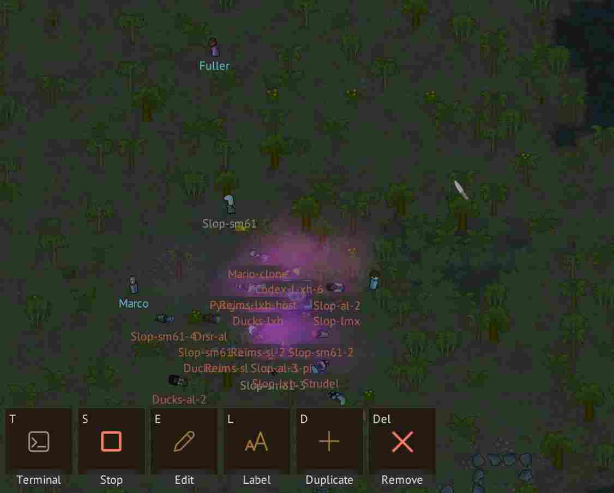
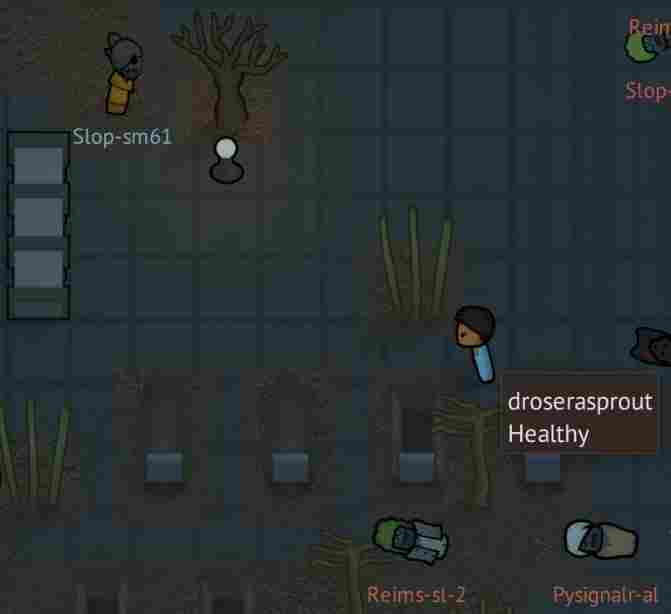

# "Gameplay"

The colony reflects sessions managed by the daemon. Configured agents appear as
pawns; workers and temporary errands remain in the sidebar. Host shells have no
agent pawn.

## Agents

Select an agent on the map and press T to open its terminal. The selected agent's
controls also let you start or stop, edit, duplicate, label, or delete it. See
[Agent controls](../reference/keyboard-shortcuts.md#agent-map-with-agent-selected)
for the default keys and [Session lifecycle](../agents/session-lifecycle.md) for what each
action preserves.

Agents can roll a red clown nose when created or when **New look** rerolls their
appearance. The result is saved with the colony.

## Construction

Agents with **Working** status receive construction work. Interrupted construction
keeps its progress. Working and Idle describe terminal activity, so construction
is not a measure of task completion. Review the CLI's result and project changes
to check the actual work.

## Player controls

The player pawn can move, cast Fireball, Rejuvenate, teleport, and use Cat whistle.
See [Player controls](../reference/keyboard-shortcuts.md#player-pawn-map) for the
key bindings.

## Cat aura

Click the cat to heal it and restore its surroundings. Each accepted pat adds ten
seconds of aura time; repeated pats stack into minutes. The charged aura follows
the cat, protecting nearby cells from plague and fire spread while healing nearby
pawns and clearing fire and filth once per simulation second. Pats less than 0.4
seconds apart count only once. Each accepted pat also has a 10% chance to turn one
nearby empty player-owned grave into a rose, where planting is possible. Occupied
graves are left alone. Charge pauses with the simulation, including Eco
mode, and resets when the colony reloads.

## Eco mode

Eco mode pauses the colony simulation and hides the map while the daemon and
agents continue running. The sidebar and terminal interface remain available;
map interaction is disabled while the map is hidden. Colony scenes temporarily
suspend Eco rest.

Periodic colony autosaves use simulation time, so they pause during Eco rest.
Agent output and project edits continue independently of colony saves. See
[Backup and recovery](../maintenance/backup-and-recovery.md) for preserving the whole workspace.

The frame limiter and VSync are separate controls under **Settings > Display**. See
[Display](../customization/settings.md#display) for frame limits and VSync.

## Saves

SlopWorld creates a colony on first launch and loads the latest saved colony on
later launches. Colony saves and agent processes have separate lifetimes: closing
the game leaves agents running while their daemon host remains available, unless
**Stop active sessions** is selected under
[Settings > General > Game > On exit](../customization/settings.md#on-exit).
See [Saves and profiles](../maintenance/game-profiles.md) and [Backup and recovery](../maintenance/backup-and-recovery.md).
